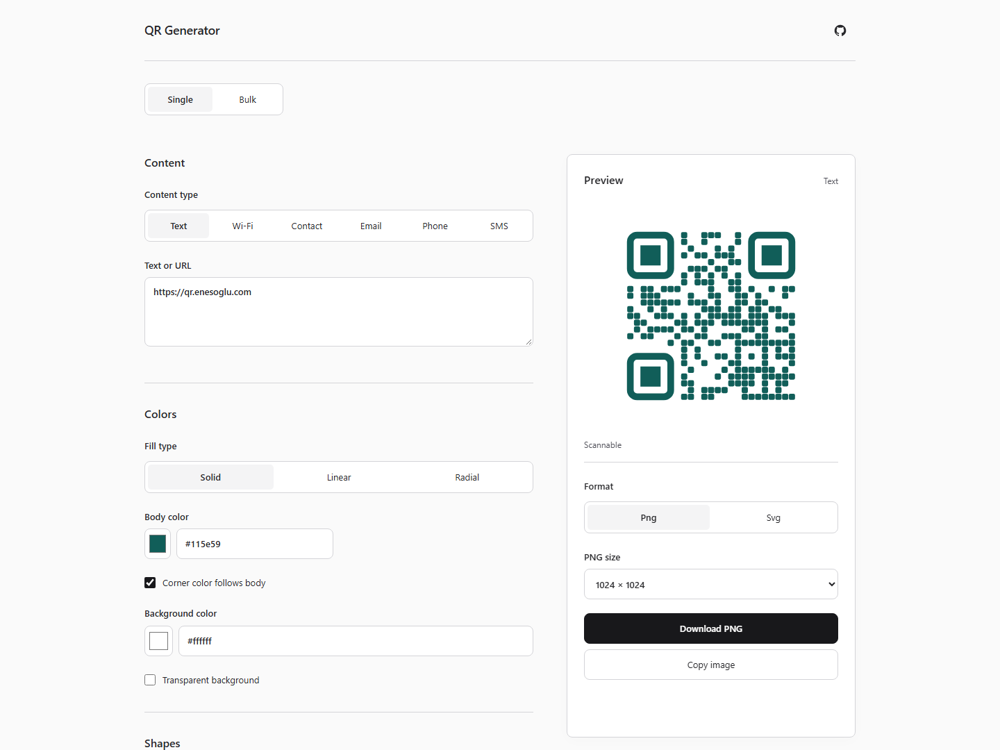

# QR Generator

A minimal, ad-free QR code generator that runs entirely in your browser.

[Open qr.enesoglu.com](https://qr.enesoglu.com)

[](https://github.com/enesoglu/qr-enesoglu-com/actions/workflows/ci.yml)
[](LICENSE)

<picture>
  <source media="(prefers-color-scheme: dark)" srcset="docs/images/editor-dark.png">
  <source media="(prefers-color-scheme: light)" srcset="docs/images/editor-light.png">
  
</picture>

## Features

- Text and URLs, Wi-Fi, contacts (vCard), email, phone and SMS.
- Custom shapes, solid colors and gradients, transparent backgrounds and local logos.
- Live preview, decode checks and contrast warnings. Test your final design with your intended scanner.
- PNG and SVG downloads; CSV, TSV and plain-text bulk input with cancellable ZIP export.
- Keyboard-accessible controls, system dark mode and offline support after the first visit.

## Privacy

QR content and images are processed locally on your device. Nothing you enter is uploaded or tracked. There are no accounts, analytics or cookies.

Only editor preferences (design settings, export options and selected content type) are saved in `localStorage`; QR payloads and bulk rows are never saved. Small uploaded logos can be retained as part of the design. The service worker caches app files for offline use. Loading the website still makes normal requests to the hosting server.

## Development

Use Node **26.13.0** (see `.nvmrc`) and **pnpm 12.18.0** through Corepack. Install Corepack if your Node distribution does not include it, then:

```sh
corepack enable
pnpm install --frozen-lockfile
pnpm dev
```

```sh
pnpm lint
pnpm typecheck
pnpm test
pnpm build
pnpm exec playwright install chromium
pnpm e2e
```

For production browser checks, build first and set `PLAYWRIGHT_PREVIEW=1` when running `pnpm e2e` (PowerShell: `$env:PLAYWRIGHT_PREVIEW='1'`). Use `pnpm preview` to serve the build locally.

Regenerate the README screenshots from the production preview:

```sh
pnpm build
pnpm preview --port 4173 --strictPort
# In another terminal:
node scripts/screenshots.mjs
```

See [CONTRIBUTING.md](CONTRIBUTING.md) for contribution guidelines.

## Project structure

```text
src/app/            React editor, state and feature panels
src/components/     Reusable UI controls
src/styles/         Responsive layout and themes
src/core/types.ts   Shared contracts
src/core/defaults.ts Default QR design
src/core/payloads/  Content encoding and validation
src/core/render/    QR matrices, shapes and SVG rendering
src/core/export/    PNG rasterization and scan diagnostics
src/core/batch/     Input parsing, filenames and ZIP generation
scripts/            Asset and screenshot generation
tests/e2e/         Browser and accessibility checks
```

See [Architecture](docs/architecture.md) for module responsibilities.

## Deployment

See the [deployment runbook](docs/deployment.md) for GitHub Actions, SSH, Caddy and rollback instructions.

## Acknowledgements

QR encoding uses [qrcode](https://github.com/soldair/node-qrcode), decoding uses [jsqr](https://github.com/cozmo/jsQR), ZIP export uses [fflate](https://github.com/101arrowz/fflate), CSV parsing uses [papaparse](https://github.com/mholt/PapaParse), and offline support uses [vite-plugin-pwa](https://github.com/vite-pwa/vite-plugin-pwa).

## License

[MIT](LICENSE).
